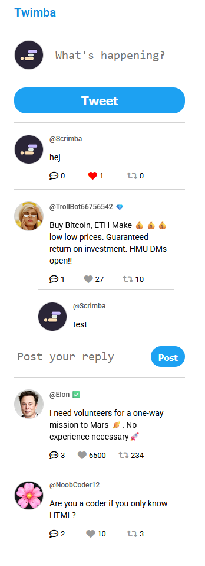

# Twimba

A Twitter-style feed built with vanilla JavaScript. Post new tweets, like and retweet,
and open threads to read and write replies.

Built as part of [Scrimba's Fullstack Developer Path](https://scrimba.com/fullstack-path-c0fullstack).


## Features

- **Post new tweets**, each with a unique ID (UUID)
- **Like and retweet** with toggling counters and highlighted icons
- **Reply threads**: show or hide replies under each tweet
- **Posting replies**: added by me on top of the course version

## Built with

- JavaScript (ES modules, event delegation with `data-*` attributes, template literals)
- HTML
- CSS, Font Awesome icons

## What I learned

- Rendering the whole feed from a single data array and re-rendering it after every change
- Using **one click listener for the whole page** and `data-*` attributes to tell which button was clicked and on which tweet
- Extending someone else's starting code with a new feature (replies) without breaking what already worked

## Next steps

- [ ] Allow deleting your own tweets

## Run locally

```bash
git clone https://github.com/wzolnierek/twimba.git
cd twimba
npm install
npm start
```
